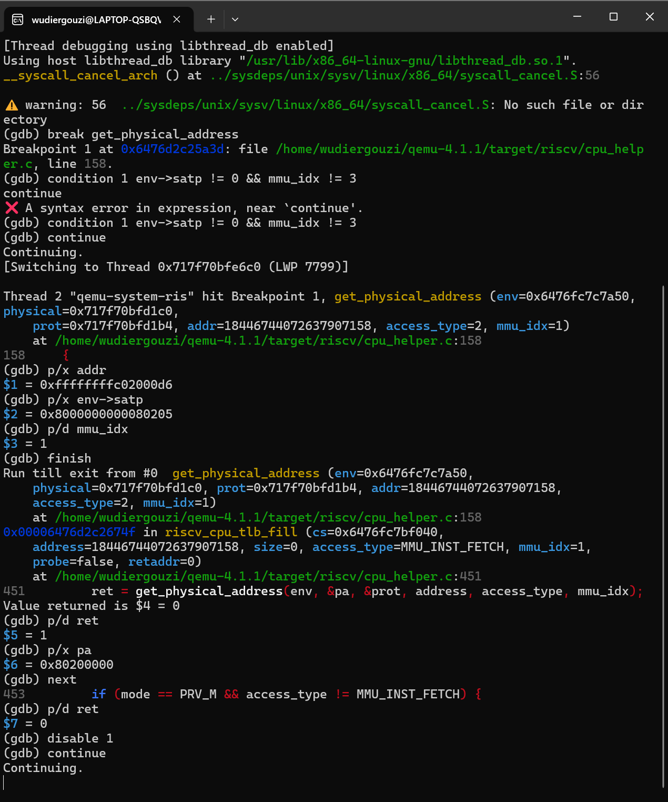
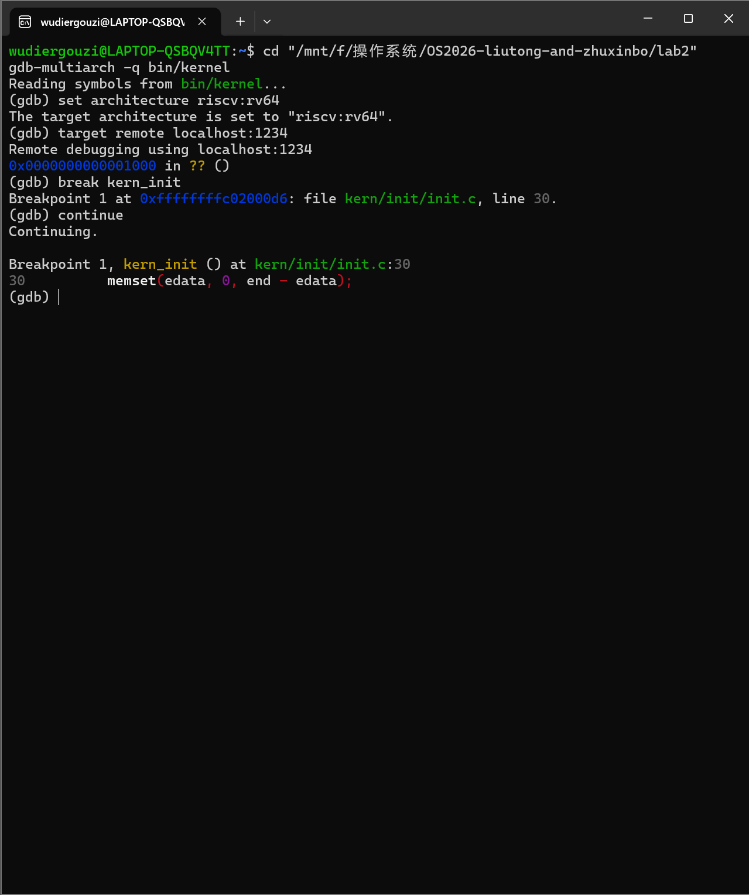
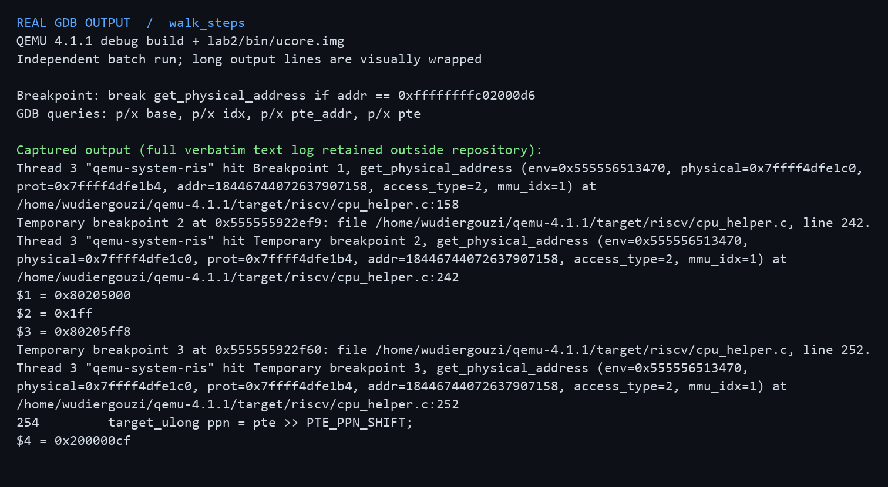
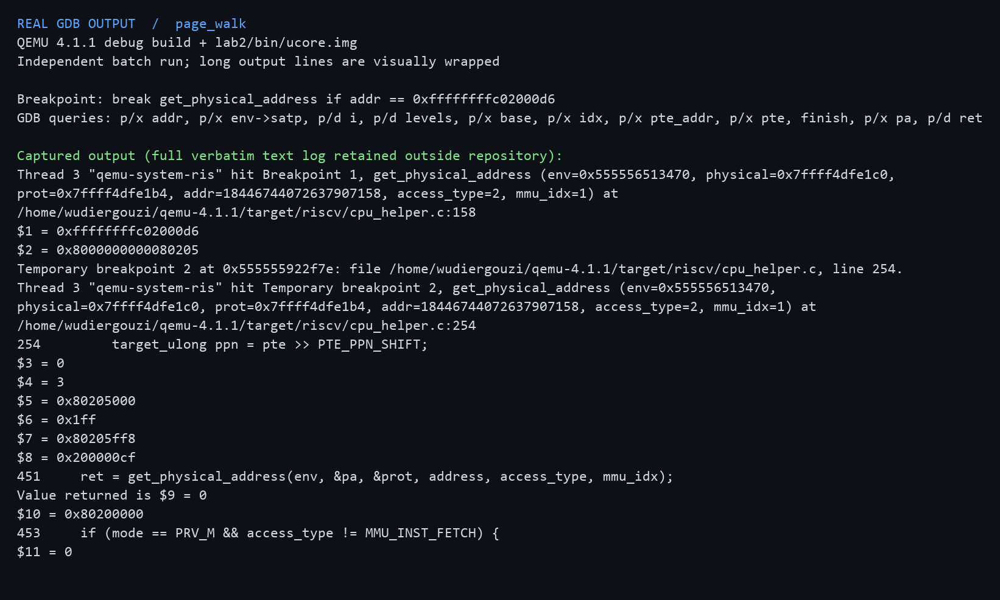
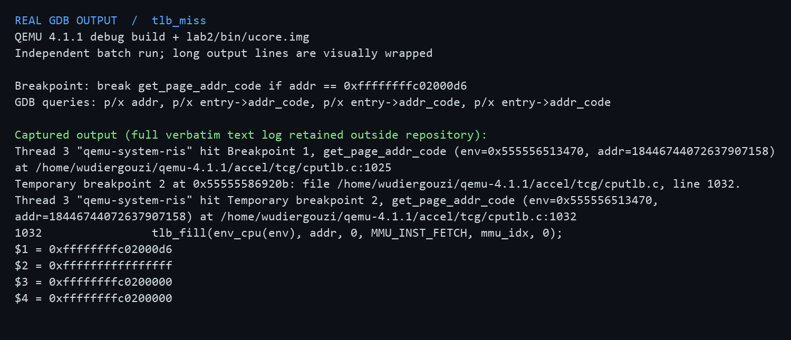
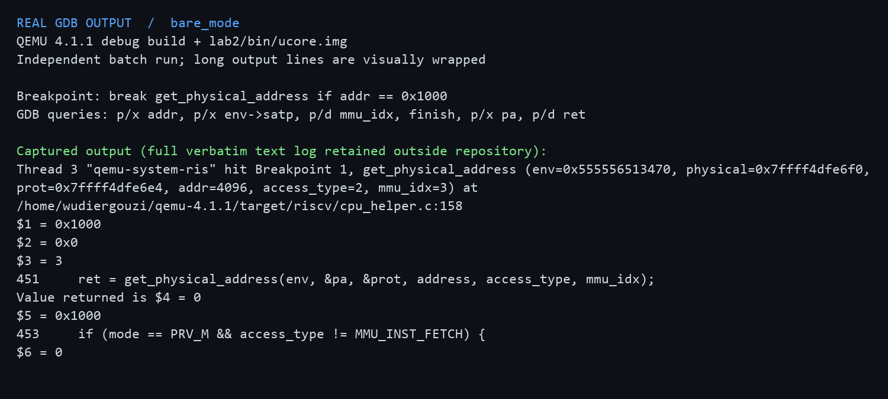
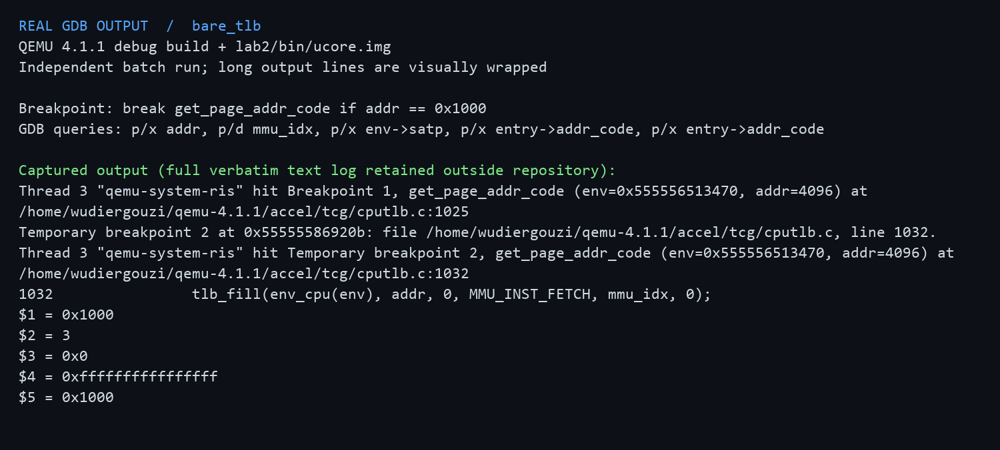

# Lab 2：物理内存管理实验报告

## 实验基本信息

| 项目 | 内容 |
|------|------|
| 实验名称 | Lab 2：物理内存管理 |
| 小组成员 | 刘通（2411526）、朱信博（2411339） |
| 最近复核日期 | 2026-10-24 |
| 代码仓库 | <https://github.com/wudiergouzi/OS2026-liutong-and-zhuxinbo> |

### 小组分工

| 成员 | 负责内容 |
|------|----------|
| 刘通（2411526） | 负责读取设备树中的内存范围，实现 `page_init`、页描述符数组的放置和保留页处理；设计 Buddy 自检，完成 SLUB 对象分配模块，并撰写报告中的初始化与 SLUB 部分。 |
| 朱信博（2411339） | 负责实现 Best-Fit 空闲块管理及 Buddy 分配模块，包括连续页的分配、拆分、释放与合并；设计 SLUB 自检，并撰写报告中的分配器与测试部分。 |

启动参数、引导页表和最后的运行检查是两个人一起处理的。上表记录的是我们实际做的部分；用到 AI 辅助的地方会在后文说明。

## 一、实验目的

Lab 1 解决了内核启动和输出的问题，但内核还不知道哪些物理内存可以分配。Lab 2 要先从设备树读出 RAM 范围，把内核和页描述符占用的空间留出来，再把剩下的页交给分配器。我们先读课程给出的 First-Fit，再实现默认使用的 Best-Fit 和独立的 Buddy 分配器；选做的 SLUB 则尝试在整页分配之上分配小对象。

## 二、实验环境

| 项目 | 环境 |
|------|------|
| 主机 | Windows；WSL Ubuntu 中构建和测试 |
| 目标平台 | QEMU `virt`，64 位 RISC-V，默认 128 MiB RAM |
| 工具 | `riscv64-unknown-elf-gcc`、`make`、`qemu-system-riscv64`、`gdb-multiarch`、Python 3、`bc` |

### AI 工具使用

刘通使用 Codex 桌面版辅助查资料、写代码和检查边界情况，朱信博使用 GPT 辅助设计和调试。我们没有完整保存当时的聊天原文，所以后文的提示词是根据实际任务重新整理的，不作为逐字记录。代码是否正确，还是以编译、QEMU 输出和课程测试为准。

## 三、实验整体逻辑分析

整个启动过程可以从 `kern_entry` 往下看。OpenSBI 把控制权和设备树地址交给内核，入口汇编保存参数，设置引导页表和 `satp`，然后跳到高地址的 C 代码。引导页表同时保留低地址和高地址映射：刚打开分页时处理器还要从当前低地址取指，跳到高地址后又要能访问内核。进入 `kern_init` 后，内核读取设备树，再调用 `pmm_init`。

`pmm_init` 先选定分配器，再让 `page_init` 建立 `Page` 数组并登记空闲页，最后运行分配器自检。正常构建选 Best-Fit，定义 `LAB2_BUDDY_TEST` 才切换到 Buddy；定义 `LAB2_SLUB_TEST` 时，还会在页分配器之上初始化并检查 SLUB。本实验的引导页表只够内核启动使用，还不是进程各自的虚拟地址空间。

对应到源码，主线是 `kern_entry -> kern_init -> dtb_init -> pmm_init -> page_init -> init_memmap`，之后才会调用 `alloc_pages`、`free_pages`。`Makefile` 负责交叉编译和启动 QEMU；`make grade` 会另建临时副本并注入课程测试，不会把测试代码留在工作目录里。

## 四、实验内容与实现

### 练习一：物理页初始化

刘通负责的 `page_init` 在 `kern/mm/pmm.c`。开始写时，我们先把手册要求和 `tools/test_lab2.c` 对在一起：它必须从设备树获取 RAM 起点和大小，设置 `va_pa_offset`、`npage`、`pages`，让内核及描述符数组占用的页保持保留状态，只把后面的完整页交给分配器。这就是我们给这一部分定的 spec；提示词也围绕这些边界来写，整理版放在本节后面的“Spec 与提示词”。

`dtb_init` 先从设备树读出内存起点和容量。`page_init` 根据内存末尾算出 `npage`，设置虚实地址偏移，再把 `pages` 放在链接符号 `end` 后第一个 4 KiB 对齐位置。这里容易漏掉一点：`pages` 数组本身也占用 RAM，因此空闲区还得从数组末尾再次向上按页对齐。`pages[0]` 对应的是 DRAM 起点，并不是物理地址 0。

我们先把管理范围内的页描述符全部标为保留，再对真正空闲的整页调用 `init_memmap`。设备树范围无效时要停止初始化；描述符数组后若没有完整页，就不能给 `init_memmap` 传入 0。这样内核映像、描述符数组和前面的固件空间都不会被误分配。`page2pa`、`pa2page` 负责在 `Page` 和物理地址之间换算，计算时都要考虑 DRAM 起点。

函数之间的关系也比较清楚：`get_memory_base` 和 `get_memory_size` 把设备树结果交给 `page_init`；`PADDR` 将算出的空闲区起点转成物理地址；`init_memmap` 把这段页交给当前分配器。`alloc_pages`、`free_pages`、`nr_free_pages` 只是统一接口的转发，调用它们的代码不必知道底层选的是 Best-Fit 还是 Buddy。

### 练习二：First-Fit 源码理解

这一练习主要是读课程给出的 `default_pmm.c`，弄清连续页是怎么在链表中表示的。`default_init` 清空链表和空闲页计数，`default_init_memmap` 把一段连续可用页登记成空闲块，块首的 `property` 记录页数。`default_alloc_pages` 从链表头开始找，遇到第一个够大的块就分配；若有剩余，再把余下的页登记成新块。`default_free_pages` 把归还的页按地址插入，与前后相邻块合并。链表按地址排序后，释放时只需看两边的邻居。

它的好处是找到第一个合适的块就能停下，但空闲块多时仍可能扫描很久，前面的块也容易被反复切分。可以按大小再建索引或分级链表来加快查找，不过释放和合并时就要多维护一套数据。后面实现的 Best-Fit 则换了一种选块方式，也不能保证长期不会产生碎片。

### 练习三：Best-Fit 连续页分配

朱信博负责 `kern/mm/best_fit_pmm.c`。课程代码已经给出了 `pmm_manager` 接口，以及不能改动的 `basic_check`、`best_fit_check`。因此我们先确定这部分要满足什么：空闲块能登记和计数，分配时必须选“够用的块里最小的那个”，释放后相邻块能合起来。这些要求也写进了给 AI 的提示词，整理版放在后面的“Spec 与提示词”一节。

实现时，链表按地址顺序保存空闲块，每个节点是块的第一个 `Page`。只有块首设置 `PG_property`，其 `property` 记录整块的页数。`best_fit_init` 初始化链表和空闲页计数，`best_fit_init_memmap` 则把一段连续可用页登记成一个块。这样，后续分配只需沿链表比较块大小，不必逐页扫描。

`best_fit_alloc_pages` 会遍历所有空闲块，找出能容纳请求且页数最少的块。没有合适的块就返回 `NULL`；块有多余页时，取走需要的部分，把剩余部分重新登记为块。比如链表中有 2 页块和 1 页块，请求 1 页时必须选 1 页块，这也是 `best_fit_check` 检查的情况。First-Fit 在这里可能直接取到先遇见的 2 页块。

`best_fit_free_pages` 把归还的页按地址插回去，再检查与前后块是否相邻。相邻就合并并更新块首信息。`nr_free` 在分配或归还页时改变，合并只是调整块的范围，不能再把同一批页计一次。`best_fit_nr_free_pages` 返回这个计数，`best_fit_pmm_manager` 把各函数接到统一接口上。原有的 `basic_check` 检查分配释放的基本行为，`best_fit_check` 进一步检查选块、计数和合并。

这种方法每次分配都得扫完整条链表，而且只顾当前请求留下的余块最小，并不能保证长期没有碎片。如果以后要优化查找，可以另建按块大小组织的索引；不过拆分和合并时也要同时维护两套结构，实现会复杂一些。

### 练习四：Buddy System（必做）

Buddy 由朱信博实现，文件是 `kern/mm/buddy_pmm.c`；刘通负责设计和检查 `buddy_check`。它同样接入 `pmm_manager`，但管理空闲块的方法不同：每个块的页数必须是 2 的幂，不同阶数各有一条链表。申请 3 页时，实际需要 4 页；如果 4 页链表为空，就找更大的块，一层层拆开。释放时，用块的页索引与块大小做异或找伙伴，只有对方同阶且空闲时才能合并。由于申请 3 页实际占了 4 页，空闲页计数也应减少 4，而不是 3。

刘通写的自检覆盖了零页和超量请求、单页分配回收、3 页请求的向上取整，以及释放后计数恢复。为了检验合并，我们还申请一段连续 4 页，分两次还回左右各 2 页，再检查它们是否重新归入至少 4 页的同一空闲块。最初曾用“再申请一次必须拿回原地址”做断言，后来发现这不是 Buddy 的保证，便改成检查块本身。默认构建仍使用课程要求的 Best-Fit；定义 `LAB2_BUDDY_TEST` 后才切换到 Buddy 并运行这组自检。

### 扩展练习：SLUB 风格小对象分配

选做的 SLUB 风格分配器由刘通实现，文件是 `kern/mm/slub.c`，朱信博负责 `slub_check`。我们把它放在已有的页分配器之上：先用 `alloc_pages` 取得整页，再把一页切成 16 到 2048 字节的几种对象。页首元数据记录尺寸档、空闲对象链表和使用数量；超过 2048 字节的请求则直接申请足够多的页。一个 slab 中的对象全部归还后，整页也会还给底层分配器。这只是实验用的简化版本，没有实现 Linux SLUB 的并发控制、每 CPU 缓存等机制。

朱信博写的 `slub_check` 包括零长度请求、跨尺寸档分配、一次分配 260 个 16 字节对象、2000 字节附近的边界，以及 4095、5000、8191 字节的大对象。测试会写入并逐字节核对内容，再检查对象复用和全部释放后的页数。260 个小对象用于检查单个 slab 装满后能否开新页；4095 和 8191 字节用于检查算页数时是否漏了页首元数据。定义 `LAB2_SLUB_TEST` 才会在 Best-Fit 自检之后运行这部分测试，普通构建不执行。

### 启动兼容性修正

代码编译通过后，QEMU 第一次启动却没有进入内核。OpenSBI 显示下一跳地址为 `0x0`，我们才回头检查启动命令，把 `Makefile` 和 `tools/grade.sh` 中的 `-device loader` 改成 `-kernel bin/ucore.img`。再启动时，下一跳地址变成了预期的 `0x80200000`。我们只调整了脚本的启动参数，没有改它注入的测试或评分规则。

随后又遇到一次“能进内核入口但没有输出”。沿着 `entry.S` 中设置 `satp` 前后的执行地址看，发现开启 Sv39 后，处理器还需要从当前低地址继续取指，而原引导页表只映射了高地址。我们便在页表索引 2 加上从 `0x80000000` 起的 1 GiB 临时恒等映射，保留索引 511 的高地址映射。这样才能顺利跳到高地址的内核代码。这项改动处理的是启动过渡，和 Best-Fit 的选块策略无关。

### AI 辅助实现中的问题与修正

AI 给出的实现建议和代码也需要跑起来才能判断对不对。比较明显的一处错误出在 SLUB 的大对象分配：原先用 `(size + PGSIZE) / PGSIZE` 算页数，没把页首元数据占的空间算进去。我们给 4095 字节请求加上断言后，QEMU 在 `page_count >= 2` 处报错。后来先把请求大小与对齐后的元数据相加，再按页向上取整，并补测了 8191 字节请求至少占 3 页，以及写满对象后释放的情况。

另一处问题在测试本身。Buddy 和 SLUB 同时开启时，旧的 Buddy 自检卡在 `pair == a`。当时我们把“合并后再申请一定拿到原地址”当成了保证，但空闲块可能继续向上合并，下一次申请又取决于链表顺序。于是我们改查两个同阶伙伴是否落在同一空闲块，并继续检查计数、重新申请和释放。组合模式重跑后，Buddy、SLUB 和基本页分配的成功标记都出现了。

还遇到过一个与算法无关的环境问题：Windows 检出后的 `tools/grade.sh` 带了 CRLF，WSL 执行时出现 `\r: not found`。转回 LF 并用 `.gitattributes` 固定换行后，评分脚本才正常运行。前一节的 QEMU 加载方式和引导映射问题也在调试过程中解决了，但我们没有留下证据能把它们归因于某一条 AI 回复，因此这里只如实记录现象和修正过程。对照完整指导书后，我们还发现 Buddy 是必做、SLUB 是选做，便补上了相应的实现与测试；每加一部分都重新在 QEMU 中检查。

### Spec 与提示词的整理

我们把指导书的要求整理成能检查的 spec，而不只写“实现一个分配器”：

| 练习 | 核心输入与行为 | 可验证的结果 |
|------|----------------|--------------|
| 页初始化 | 读取 DTB 的 RAM 起点和容量，按页建立 `Page` 数组，排除固件、内核与数组自身 | 地址换算正确；仅完整空闲页入管理器；无空闲整页不调用 `init_memmap`；无效 DTB 终止 |
| First-Fit | 阅读四个 `default_*` 函数及空闲链表 | 能说明初始化、首次匹配、拆分、释放与相邻合并，并回答改进空间 |
| Best-Fit | 沿用 `pmm_manager` 接口，保持课程的两个 `check` 不变 | 选择满足请求的最小空闲块，正确拆分/合并；默认管理器切换为 Best-Fit |
| Buddy | 独立实现 2 的幂页块、分阶链表和伙伴合并，另写测试 | 模块可编译运行；测试覆盖分裂、合并、舍入、失败和计数 |
| SLUB 扩展 | 在页分配之上提供不同大小对象 | 模块可编译运行；测试覆盖尺寸档、跨页、复用和回收 |

下面是根据这些要求整理的提示词。我们当时没有完整保存聊天原文，所以这里不是逐字转录，但保留了真正用来约束实现和测试的要点。

> 页初始化：请阅读 `kern/mm/pmm.c`、`pmm.h`、`memlayout.h` 和 DTB 接口。仅补 `page_init`：用设备树给出的 RAM 范围设置 `va_pa_offset`、`npage`、`pages`，将内核及页描述符数组覆盖的页保留，只把之后的完整页交给 `init_memmap`。请明确虚拟地址、物理地址和页号的换算；处理无效内存范围、整数溢出和没有空闲完整页的情况；保留 `lab2` 注释并标学号。最后给出可以验证边界的测试思路。

> Best-Fit：参考 `default_pmm.c` 和 `pmm_manager` 接口，只在 `best_fit_pmm.c` 的学生实现区域加入初始化、登记、分配、释放、计数与注册结构。遍历所有足够大的空闲块，取最小者；按地址维护链表，拆分与合并时保持块首 `property`、`PG_property`、`nr_free` 一致。不要修改已有的 `basic_check`、`best_fit_check`；在 `pmm.c` 选择 Best-Fit，并说明比 First-Fit 多出的扫描开销。

> Buddy 实现：请从零编写符合 `struct pmm_manager` 的 RISC-V ucore Buddy 模块。空闲块大小必须为 2 的幂；初始区间拆成对齐块；分配时向上取整并逐阶拆分；释放时仅与同阶空闲伙伴合并。保留页保留标志和空闲页计数的不变量，不修改现有 Best-Fit 检查。提供独立编译开关，让默认构建继续使用 Best-Fit。

> Buddy 测试：请针对上一条实现写内核自检，至少覆盖 `n=0`、请求超过可用页、单页分配、连续 4 页分两半释放后的伙伴合并、非 2 的幂请求的实际占用、释放后的空闲页计数恢复。不要假设再次申请必定取回同一地址；断言需说明能抓到哪类错误，并让测试在 QEMU 启动时输出明确成功标记。

> SLUB 实现：请在现有页分配器之上实现一个简化的任意大小对象分配模块。小对象按 2 的幂尺寸档切分单页，slab 记录空闲对象和使用计数；较大请求直接分配足够多的页。空 slab 归还底层页分配器。给出 `init/alloc/free` 接口，不引入主机 libc 或动态堆，不改变默认评分路径。

> SLUB 测试：请检查 0 字节、多个尺寸档、4095 和 8191 字节这类含元数据后会跨越页边界的对象、跨页大对象、释放后复用及所有对象释放后底层空闲页计数恢复。断言失败时让内核明确报错，成功时打印可辨认的检查标记。

这些提示词帮助我们把边界条件说清楚；最后是否满足要求，仍要回到源码、断言和运行结果来看。

## 五、测试与验证

在 WSL Ubuntu 中运行 `make` 后，包含新增模块在内的 15 个源文件都编译完成，生成了 `bin/kernel` 和 `bin/ucore.img`。接着启动 QEMU，看到的关键输出是：

```text
Domain0 Next Address        : 0x0000000080200000
Physical Memory from DTB:
  Base: 0x0000000080000000
  Size: 0x0000000008000000 (128 MB)
memory management: best_fit_pmm_manager
check_alloc_page() succeeded!
```

下面两张图分别记录了编译和 OpenSBI 启动，以及内核读到的内存信息与 Best-Fit 检查结果：


内核最后会停在无限循环中，所以 QEMU 不会自行退出。手动运行时按 `Ctrl+A`、`X` 退出；自动复核时用 `timeout` 停止。这个超时不表示断言失败。

`make grade` 会在临时目录里复制源码并注入课程测试，原目录不会被改动。我们的结果是：

```text
lab2 injection complete
  -check page init:                          OK
  -check best fit:                           OK
Total Score: 20/20
```

评分终端的截图也保留在报告中：


这 20 分对应两项注入检查：页初始化的地址、对齐、保留页和转换关系，以及默认是否选择 Best-Fit。分配、拆分和合并的行为，还要看内核启动时原有的 `basic_check`、`best_fit_check`；它们通过后才会打印 `check_alloc_page() succeeded!`。所以 20/20 不能单独代表 Buddy 和 SLUB 也已通过。

Buddy 和 SLUB 需要另外运行。我们在 `lab2` 目录依次执行下面的命令；每次切换 `DEFS` 都先清理，免得用上一次的宏编出的目标文件：

```sh
make clean && make DEFS=-DLAB2_BUDDY_TEST
timeout 12s make qemu
make clean && make DEFS=-DLAB2_SLUB_TEST
timeout 12s make qemu
make clean && make 'DEFS=-DLAB2_BUDDY_TEST -DLAB2_SLUB_TEST'
timeout 12s make qemu
make grade
```

切到 Buddy 时，输出里有 `memory management: buddy_pmm_manager`、`buddy_check() succeeded!` 和 `check_alloc_page() succeeded!`。单独启用 SLUB 时，Best-Fit 自检后又出现 `slub_check() succeeded!`；两个开关一起打开，三个成功标记也都出现。最后重新运行课程脚本，仍得到 20/20。课程脚本本身不给 Buddy 和 SLUB 评分，我们只把它们各自的内核自检结果作为验证依据。

### 扩展思考：如何获知物理内存范围

如果内核事先不知道机器有多少物理内存，就得从固件或启动加载器提供的信息里找。本实验读的是设备树的 `/memory` 节点；其他平台也可能提供固件内存映射表。读到 RAM 范围以后，还要扣除固件、内核和设备保留区，不能把整段 RAM 都当成空闲页。我们的实现仍以 QEMU `virt` 的 DRAM 起点和布局为前提，不能不加修改就用于任意机器。

### 分支任务：双 GDB 观察 QEMU 页表查询

这项调试不计入 `make grade` 的 20 分，做它是为了看清 QEMU 实际怎样查页表。我们另外从 QEMU 4.1.1 源码用 `--enable-debug` 编译了 `riscv64-softmmu/qemu-system-riscv64`，没有 `make install`，系统自带的 QEMU 仍保持原样。调试时开三个终端：一个用 `-s -S` 启动 QEMU，一个用主机 x86-64 GDB 附加 QEMU 进程看模拟器源码，另一个用 `gdb-multiarch` 连 1234 端口看客户机内核。普通用户附加进程时遇到了 `ptrace: Operation not permitted`，改用 `sudo gdb` 后成功，没有长期修改 `ptrace_scope`。下面是两个 GDB 同时工作的终端截图：





**先理清调用路径。** 我们单步的是内核入口取指。QEMU 4.1.1 会先在 `accel/tcg/cputlb.c:get_page_addr_code` 中按 `mmu_idx` 和虚拟地址查软件 TLB，没找到再查 victim TLB，还没命中才调用 `tlb_fill`。接下来进入 RISC-V 的 `riscv_cpu_tlb_fill`，再由 `get_physical_address` 根据 `satp` 做 Sv39 页表查询。成功后，`tlb_set_page` 把映射和权限写回软件 TLB。数据读写分别走 `load_helper`、`store_helper` 等路径；我们实际单步的是取指，不能把它说成所有访存指令都走同一个入口。

**跟一次页表查询。** 客户机 GDB 停在 `kern_init` 时，PC 是 `0xffffffffc02000d6`；主机 GDB 在 `get_physical_address` 看到了同一地址，`access_type=2` 表示取指，`mmu_idx=1` 表示 S 模式。此时 `satp=0x8000000000080205`，模式是 Sv39，根页表物理地址为 `0x80205000`。在 `cpu_helper.c` 的循环里单步后，记录到 `levels=3`、`i=0`、`idx=0x1ff`、`pte_addr=0x80205ff8`、`pte=0x200000cf`。循环用虚拟地址取当前级索引，算出 `base + idx * ptesize`，从客户机物理内存读出 PTE，再检查有效位、叶子权限、对齐和访问权限。

这个 PTE 的 V/R/W/X 位都是 1，是映射 1 GiB 的顶级叶子项。因此 Sv39 虽然最多查三级，这次只走了第一级。PTE 的 PPN 对应 `0x80000000`，加上虚拟地址在大页内的偏移 `0x2000d6`，得到物理地址 `0x802000d6`。QEMU 返回给 TLB 的页基址是 `0x80200000`，`ret=0` 表示转换成功。调试时我们曾在 `finish` 后看见调用者的 `ret=1`，后来发现赋值语句还没执行；再单步一次 `next` 才得到正确的 `ret=0`。

我们还单独在计算 `pte_addr` 和执行 `ldq_phys` 的地方用 GDB `next` 单步：从基址 `0x80205000` 和索引 `0x1ff` 算出了 `0x80205ff8`，下一步读到的 PTE 正是 `0x200000cf`。





**再看 TLB 填充。** 对同一虚拟地址，在调用 `tlb_fill` 前，`entry->addr_code=0xffffffffffffffff`，说明还没有可用的取指映射；填充后变为 `0xffffffffc0200000`，即目标地址所在虚拟页的标签。随后源码中的 `assert(tlb_hit(...))` 也能通过。由此可以看到，QEMU 先尝试软件 TLB，未命中才查页表并填充，不是每次取指都重走页表。QEMU 的 TLB 条目还会保存 `addend` 等用于访问主机 RAM 的信息；真实 CPU 的硬件 TLB 逻辑上缓存的是地址翻译和权限，不会保存 QEMU 的主机指针。



**最后做一个对照。** 在初始 M 模式取地址 `0x1000` 的指令时，测得 `satp=0`、`mmu_idx=3`。`get_physical_address` 直接返回物理地址 `0x1000`，没有进入 Sv39 查表循环。不过 QEMU 的软件 TLB 条目起初仍是 `0xffffffffffffffff`，填充后取指标签变为 `0x1000`。这说明“QEMU 用软件 TLB 加快模拟访问”和“客户机有没有开启页表翻译”是两回事。这里是恒等映射，不能说真实硬件在 bare 模式也查了页表。





调试时，我们借助 Codex 定位了 QEMU 4.1.1 中的几个关键函数，并用条件断点只观察指定虚拟地址，最后靠 GDB 的实际数值核对了“TLB 未命中、查页表、填充”的过程。这里写的是过程摘要，不是聊天逐字记录。其中五张证据图由另起的调试版 QEMU 实例输出生成，是 GDB 文本转图，不是人工终端截图；完整日志和独立测试脚本放在仓库外。

## 六、实验知识与 OS 原理

| 本实验中的知识点 | 对应的 OS 原理、联系与区别 |
|------------------|----------------------------|
| 设备树提供 RAM 起点和容量 | OS 必须先知道可管理的物理资源范围。设备树描述硬件，页分配器负责管理资源；设备树信息本身不是空闲页表。 |
| `Page` 数组、`PG_reserved` 与空闲链表 | 这是物理页框管理的元数据。`Page` 描述一页，链表节点只代表连续空闲块的首页；保留页虽有描述符，却不能参与分配。 |
| Best-Fit 与 First-Fit | 二者都是连续内存的动态分配策略。Best-Fit 要遍历候选块以减少本次分配的剩余块大小，但不保证全局没有外部碎片；First-Fit 遇到第一个足够大的块就停止。 |
| Buddy 的阶数和伙伴 | 伙伴系统按 2 的幂管理连续页，用页索引异或块大小定位同阶伙伴并在释放时合并。它减少查找和合并的复杂性，但请求向上取整会带来内部碎片；与 Best-Fit 面对的外部碎片不是一回事。 |
| SLUB 的两层分配 | 页分配器处理整页，SLUB 在页内按大小档切出对象。两者管理粒度不同；本实验的简化版能回收空 slab，但没有实现真实内核中的并发与每 CPU 缓存。 |
| Sv39、`satp` 和高低地址映射 | 它们属于地址转换机制，解决内核启动后如何继续取指；Best-Fit 管理的是物理页框，二者有关联但不是同一个功能。本实验只有引导时的内核映射，没有为每个进程建立独立页表。 |
| `page2pa`、`pa2page` 与 `PADDR` | 前两者在页描述符和物理地址之间转换，计算时考虑 DRAM 起点 `nbase`；`PADDR` 则把内核高虚拟地址减去固定偏移得到物理地址。输入对象不同，不能互换。 |

学到这里，我们也意识到还有几项 OS 原理并没有在本实验中实现：

- **进程地址空间和权限隔离。** 这里没有进程，也没有为不同进程建立各自的页表；引导页表只服务于内核启动。
- **缺页异常、按需分配与页面置换。** 本实验能主动分配物理页，但没有处理访问未映射地址的异常，也不会在内存不足时把页面换出。
- **并发分配与同步。** 当前分配器没有演示多个 CPU 同时修改空闲链表时的锁或其他同步机制，单机测试通过不代表并发情况下也正确。

因此，`make grade` 的 20/20 只说明课程脚本检查的页初始化与 Best-Fit 通过。Buddy、SLUB 还得看各自的构建和自检；这些结果也不等于完整的虚拟内存系统已经做好。

## 七、实验总结与收获

做这次实验时，我们最开始容易把几种地址混在一起。设备树给的是物理 RAM 范围，链接脚本安排的是内核高虚拟地址，`Page` 数组保存的又是物理页的描述信息。后来对着 `page_init` 和地址转换函数逐步核对，才弄清 `PADDR` 是从内核高地址求物理地址，`page2pa` 则根据描述符在 `pages` 中的位置求对应物理页，两者不能混用。

写分配器时最需要小心的是状态一致：链表里只放空闲块的首页，首页的 `property` 记录块的页数，`nr_free` 还得与实际空闲页数相符。拆分和合并只要漏改一处，后面的检查就会暴露问题。Buddy 让我们看到按 2 的幂取整虽然方便合并，却会占用多余页；SLUB 则让我们把“分配整页”和“在页里分配对象”连了起来。进程地址空间、缺页异常和页面置换等内容，还要到后续实验继续学。
