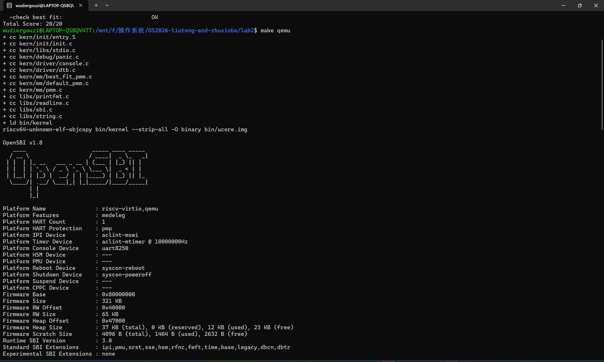
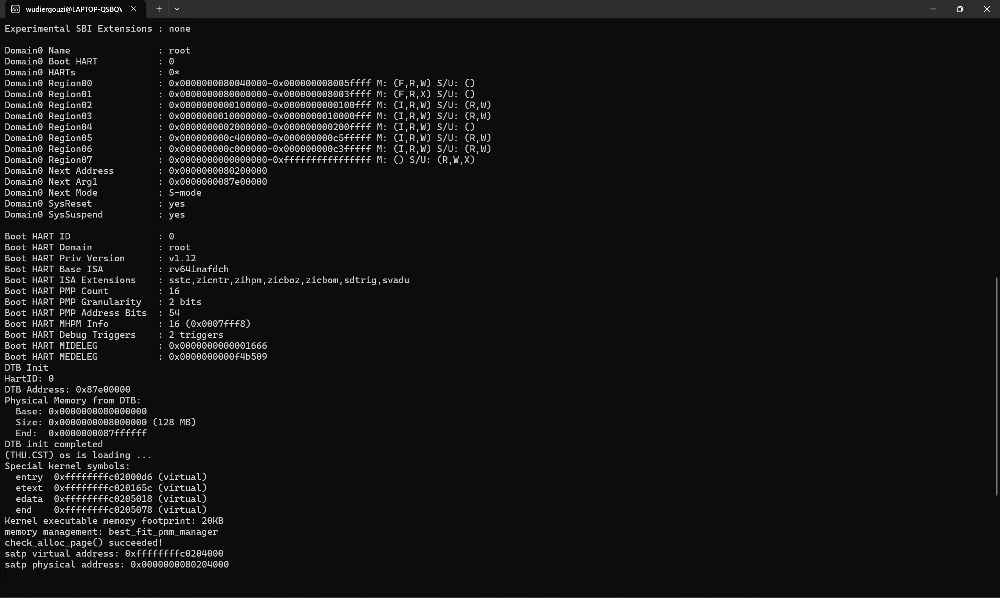
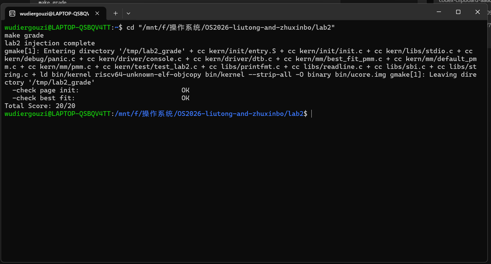

# Lab 2：物理内存管理实验报告

## 实验基本信息

| 项目 | 内容 |
|------|------|
| 实验名称 | Lab 2：物理内存管理 |
| 小组成员 | 刘通（2411526）、朱信博（2411339） |
| 完成日期 | 2026-10-23 |
| 代码仓库 | <https://github.com/wudiergouzi/OS2026-liutong-and-zhuxinbo> |

### 小组分工

| 成员 | 负责内容 |
|------|----------|
| 刘通（2411526） | 负责读取设备树中的内存范围，实现 `page_init`、页描述符数组的放置和保留页处理，并撰写报告中的初始化部分。 |
| 朱信博（2411339） | 负责实现 Best-Fit 空闲块管理，包括连续页的分配、拆分、释放与合并，并撰写报告中的分配器和测试部分。 |

启动参数和引导页表的适配、内核启动过程的检查，以及最终测试结果的核对由两人共同完成。以上是原有练习的实际分工；新增 Buddy、SLUB 模块由 Codex 协助起草，两位成员应在答辩前共同阅读、复核，不能把尚未核实的新增分工写成既有事实。

## 一、实验目的

Lab 1 中我们已经让内核启动并输出信息。Lab 2 要解决的是物理内存如何管理：先从设备树确定内存范围，区分已占用和可用的物理页，再建立 `Page` 描述符和空闲链表，使内核可以按 Best-Fit 策略分配、释放连续页。

## 二、实验环境

| 项目 | 环境 |
|------|------|
| 主机 | Windows；WSL Ubuntu 中构建和测试 |
| 目标平台 | QEMU `virt`，64 位 RISC-V，默认 128 MiB RAM |
| 工具 | `riscv64-unknown-elf-gcc`、`make`、`qemu-system-riscv64`、Python 3、`bc` |

### AI 工具使用

实验过程中，刘通使用 Codex 桌面版查阅实验说明、检查源码，并在本次补充中起草 Buddy、SLUB 代码和测试；朱信博按小组记录使用 DeepSeek 验证与调试。具体模型版本和 DeepSeek 逐字对话未留存。报告中的实现与测试结论以源码、QEMU 输出及课程脚本的实际结果为准。下文的 prompt 是根据工作内容整理的复述版，不冒充历史聊天记录。

## 三、实验整体逻辑分析

启动时，OpenSBI 将控制权交给内核的汇编入口。入口代码启用 Sv39 分页，并为同一段物理内存建立临时的低地址映射和高地址映射。这样写入 `satp` 后，处理器还能继续取到入口代码，随后才跳转到高地址的 C 代码。`kern_init` 读取设备树，再调用 `pmm_init` 初始化物理内存管理器。

`pmm_init` 先初始化空闲链表，再通过 `page_init` 确定物理内存边界、建立页描述符，并保留内核和描述符数组占用的页。剩下的可用页交给 Best-Fit 管理器，之后运行分配器自检。这里使用的引导页表只是为了让内核切换到高地址运行，本实验还没有实现进程的虚拟内存管理。

按实际执行顺序，可以把本章连成一条线：OpenSBI 加载内核并传入设备树地址；`kern_entry` 保存参数、设置 `satp`、切换到高地址和内核栈；`kern_init` 清空 BSS，调用 `dtb_init` 读取 RAM 范围并初始化控制台；`pmm_init` 选择 Best-Fit 管理器，调用 `page_init` 建立物理页描述符和空闲区；最后执行分配器检查并打印结果。`Makefile` 负责交叉编译、链接和启动 QEMU，`make grade` 则在临时副本中注入课程测试后评分。

## 四、实验内容与实现

### 练习一：物理页初始化

这一部分由刘通完成，核心代码是 `kern/mm/pmm.c` 中的 `page_init`。

**规格（spec）怎么确定。** 课程包在 `pmm.c` 留有 `lab2 function1 YOUR CODE`，需要补上 `page_init`。我们把接口和 `tools/test_lab2.c` 的检查条件合在一起理解：从设备树取 RAM 起点与大小；设置 `va_pa_offset` 和 `npage`；把 `pages` 放在内核 `end` 后的页对齐位置；内核映像及描述符数组占用的页保持保留状态；只有数组之后的完整物理页进入空闲链表。页描述符与物理地址之间还必须能通过 `page2pa`、`pa2page` 正确往返。这些是根据课程包和测试整理的规格要点，不是课程网页的逐字原文。

**prompt 怎么写。** 复述版提示词是：“请根据 `pmm.h`、`memlayout.h` 中的地址转换关系，补全 `pmm.c` 的 `page_init`。内存范围从设备树读取，描述符数组放在内核 `end` 之后；先保留所有页，再只把数组之后可用的页交给 `init_memmap`。请说明页对齐、`nbase` 偏移和 `PADDR` 的用途，不要改课程测试。” 这样写的重点是给出输入、边界和不能改动的部分，而不是只让工具‘写一个页初始化函数’。

`dtb_init` 已从设备树取得内存起始地址与容量。`page_init` 以此计算内存末尾的页号 `npage`，并设置内核虚拟地址到物理地址的固定偏移。`pages` 数组放在链接脚本符号 `end` 之后，向上对齐到 4 KiB；数组中每个 `Page` 对应一页物理内存。数组本身也占内存，所以真正的空闲区必须从数组末尾再次按页对齐后开始。

初始化时先把全部页描述符标为保留，再只对空闲区调用 `init_memmap`。这样内核映像的末尾页、页描述符数组所在页和固件所在范围不会误入空闲链表。`page2pa`、`pa2page` 用页描述符索引与物理页号互相转换；这里的 `pages[0]` 对应 DRAM 起点，而不是物理地址 0。

**核心函数与模块。** `dtb_init` 校验设备树并保存内存起点、容量，`get_memory_base` 和 `get_memory_size` 把这两个值交给 `page_init`。`page_init` 先检查范围有效，再计算 `npage` 和描述符数组所占空间；它用 `PADDR` 把算出的空闲区起点从内核虚拟地址转成物理地址，因此不会把描述符数组本身分出去。`init_pmm_manager` 选定 Best-Fit 并清空链表；`init_memmap` 把可用区转交给管理器。`pmm_init` 串起这些步骤，随后 `check_alloc_page` 调用管理器的 `check` 自检。`alloc_pages`、`free_pages`、`nr_free_pages` 是统一接口的转发函数，内核其余代码不用直接依赖具体算法。

### 练习二：First-Fit 源码理解

`default_init` 清空链表并把空闲页计数置零；`default_init_memmap` 将一段可用的连续页登记成一个空闲块，块首 `property` 记录长度，链表按地址排序。`default_alloc_pages` 从头扫描，遇到第一个足够大的块便取走所需页数；若有余量，余下部分用新的块首重新入链。`default_free_pages` 先重置页状态，按地址插回链表，再与前后相邻块合并。链表排序的意义在于，释放时只检查两个邻居就能完成合并。

First-Fit 可以改进：线性扫描在空闲块很多时较慢，低地址区域也容易反复被切成碎片。按大小建立索引或分级链表可以加快查找，但维护索引会增加更新成本；Best-Fit 则尝试减少每次分配后留下的尾部碎片，却不保证全局碎片一定更少。

### 练习三：Best-Fit 连续页分配

这一部分由朱信博完成，核心代码在 `kern/mm/best_fit_pmm.c`。`pmm_manager` 指向 `best_fit_pmm_manager`，通过它提供初始化、分配、释放、计数和检查接口。课程包中的 `basic_check` 和 `best_fit_check` 没有改动。

**规格（spec）怎么确定。** 课程包在 `best_fit_pmm.c` 留有 `lab2 function2-2 YOUR CODE`，并已给出 `pmm_manager` 接口和不可修改的检查函数。我们据此把任务拆成五件事：建立空闲链表；把初始连续空闲页登记成块；分配时找能容纳请求的最小块，并在需要时拆分；释放时按地址插入并合并相邻块；随时保证 `nr_free` 等于空闲页总数。`best_fit_check` 中“2 页块和 1 页块同时存在时，请求 1 页应拿到 1 页块”的断言，是验证选择策略的直接依据。

**prompt 怎么写。** 复述版提示词是：“请只实现 `best_fit_pmm.c` 中留空的 Best-Fit 管理器，保持 `basic_check`、`best_fit_check` 不变。空闲链表按物理页地址排序，链表节点只代表空闲块首；分配时遍历全部可用块选最小的足够大块，拆分后维护 `property` 和标志；释放时合并前后相邻块，`nr_free` 只按实际释放或分配的页数变化。请解释每种情况下链表与计数如何保持一致。” 这个描述明确了策略、不变量和测试边界。

空闲链表按页地址升序保存每个空闲块的首个 `Page`。块首的 `property` 记录连续页数，`PG_property` 标志说明它确实是空闲块首。分配 `n` 页时遍历整条链表，挑选能够容纳 `n` 页且长度最小的块；如果块较大，就把剩余部分作为新空闲块放回链表。释放时先按地址插入，再分别检查前后是否紧邻，能合并就合并。`nr_free` 只在实际分配或释放时增减，合并不重复计数。

例如请求 1 页，而空闲块分别有 2 页和 1 页，Best-Fit 应选 1 页块；First-Fit 只会选遇到的第一个足够大的块。两者的区别是选择策略，释放时都要维护空闲块边界与总空闲页数。

**核心函数与模块。** `best_fit_init` 初始化双向链表并把 `nr_free` 置零。`best_fit_init_memmap` 清除可用页的保留状态，把整段登记为一个空闲块，按地址插入链表。`best_fit_alloc_pages` 遍历完整链表选块；找不到就返回 `NULL`，找到后取出块，若有剩余则把剩余部分作为新块放回原位置，再把空闲页数减去请求量。`best_fit_free_pages` 重置释放页的描述符、按地址插入，并先与前一块、再与后一块合并；合并只改变块的边界，不重复增加 `nr_free`。`best_fit_nr_free_pages` 返回当前空闲页数。`best_fit_pmm_manager` 把这些函数接到统一接口上。原有的 `basic_check` 检查基本分配释放行为，`best_fit_check` 还检查链表计数、精确选块和合并后的连续分配。

### 练习四：Buddy System（必做）

新增 `kern/mm/buddy_pmm.c`，按照 `pmm_manager` 接口实现独立的伙伴分配器。它把空闲页拆成地址对齐、长度为 2 的幂的块，每个阶数一条链表。请求 3 页时实际取 4 页；如果相应阶数没有空闲块，就从更大块逐级平分。释放时用页索引与块大小异或找到伙伴，只有伙伴同阶且空闲才合并。`nr_free_pages` 统计的是实际空闲页数，所以 3 页请求会减少 4 页。为了不改变课程的 Best-Fit 评分环境，普通构建仍选 Best-Fit；定义 `LAB2_BUDDY_TEST` 后才切换到 Buddy 并执行其自检。

测试函数 `buddy_check` 检查零页与超量请求、两个单页的分配与回收、合并后重新取得 2 页、3 页请求向上取整为 4 页、以及释放后空闲页总数恢复。这里同时检查“地址相邻”和“计数恢复”，仅看返回非空无法发现错误合并或计数丢失。

### 扩展练习：SLUB 风格小对象分配

新增 `kern/mm/slub.c`。第一层通过现有 `alloc_pages` 获取物理页；第二层在单页里切出 16、32、64、128、256、512、1024、2048 字节的对象。每页开头的 slab 元数据记录所属尺寸档、空闲对象链表和使用数；大于 2048 字节的请求直接跨页分配。对象归还后，空 slab 会把整页还给底层页分配器。这是体现两层结构的简化实现，并非 Linux SLUB 的完整并发、每 CPU 缓存和调试机制。

`slub_check` 覆盖零长度、一次分配 260 个 16 字节对象以跨越单个 slab、跨尺寸档分配、2000 字节边界附近、5000 字节跨页对象、写入后逐字节核对、释放后复用，以及全部释放后底层空闲页计数恢复。普通构建不运行扩展测试；定义 `LAB2_SLUB_TEST` 后才在 Best-Fit 自检完成后执行。

### 启动兼容性修正

第一次编译通过后，我们发现 QEMU 没有进入内核：原来的 `-device loader` 启动方式使 OpenSBI 报告的下一跳地址为 `0x0`。我们把 `Makefile` 和课程包自带的 `tools/grade.sh` 中的 QEMU 启动参数改为 `-kernel bin/ucore.img`，下一跳地址才变为 `0x80200000`。评分脚本的检查项目、注入测试代码和分值没有改动。

第二次运行时，OpenSBI 已到达内核入口，但仍看不到内核输出。检查入口汇编和页表后，我们发现开启 Sv39 时还需要从当前低地址继续取几条指令，而原引导页表只有高地址映射。于是我们在页表索引 2 加入从 `0x80000000` 开始的 1 GiB 临时恒等映射，同时保留索引 511 的高地址映射。修改后内核可以正常跳到高地址继续运行。这部分是启动过渡所需的修正，不影响 Best-Fit 的分配策略。

### AI 辅助实现中的问题与修正

AI 辅助阅读和检查代码后，我们仍以实际编译和运行结果判断是否正确。第一次遇到的是 QEMU 已启动但 OpenSBI 的下一跳是 `0x0`，说明问题在加载方式，尚未运行到 `page_init` 或分配器。对照 `Makefile` 与 QEMU 输出后改用 `-kernel`，再观察下一跳变为 `0x80200000`。第二次是已经跳到内核入口却没有输出；沿着 `satp` 写入前后的取指地址检查，发现缺少低地址临时映射，于是补上恒等映射并重新运行。两处问题都发生在 AI 辅助实现、检查和调试的过程中，但现有记录不足以证明它们分别来自哪条 AI 回复，因此不把课程包原有的启动参数问题硬说成“AI 生成错误”。修正后的依据是 QEMU 启动输出和分配器检查结果，而不是工具给出的文字判断。

最初的任务表述为“像上次一样继续完成 lab2”；后来对照下载的完整指导书，发现 Buddy 是必做、SLUB 是选做加分，才补上这两个模块。每次增加代码后都重新构建并在 QEMU 中检查，不把尚未运行的路径写成已验证。

### Spec 与提示词的整理

我们把指导书中的自然语言要求先改写为可以检查的 spec：

| 练习 | 核心输入与行为 | 可验证的结果 |
|------|----------------|--------------|
| 页初始化 | 读取 DTB 的 RAM 起点和容量，按页建立 `Page` 数组，排除固件、内核与数组自身 | 地址换算正确；仅完整空闲页入管理器；无空闲整页不调用 `init_memmap`；无效 DTB 终止 |
| First-Fit | 阅读四个 `default_*` 函数及空闲链表 | 能说明初始化、首次匹配、拆分、释放与相邻合并，并回答改进空间 |
| Best-Fit | 沿用 `pmm_manager` 接口，保持课程的两个 `check` 不变 | 选择满足请求的最小空闲块，正确拆分/合并；默认管理器切换为 Best-Fit |
| Buddy | 独立实现 2 的幂页块、分阶链表和伙伴合并，另写测试 | 模块可编译运行；测试覆盖分裂、合并、舍入、失败和计数 |
| SLUB 扩展 | 在页分配之上提供不同大小对象 | 模块可编译运行；测试覆盖尺寸档、跨页、复用和回收 |

下面是围绕上述 spec 整理的可复现提示词。提示词要求保留课程检查函数，不把“编译成功”当作测试通过；代码仍需由小组阅读和运行验证。

> 页初始化：请阅读 `kern/mm/pmm.c`、`pmm.h`、`memlayout.h` 和 DTB 接口。仅补 `page_init`：用设备树给出的 RAM 范围设置 `va_pa_offset`、`npage`、`pages`，将内核及页描述符数组覆盖的页保留，只把之后的完整页交给 `init_memmap`。请明确虚拟地址、物理地址和页号的换算；处理无效内存范围、整数溢出和没有空闲完整页的情况；保留 `lab2` 注释并标学号。最后给出可以验证边界的测试思路。

> Best-Fit：参考 `default_pmm.c` 和 `pmm_manager` 接口，只在 `best_fit_pmm.c` 的学生实现区域加入初始化、登记、分配、释放、计数与注册结构。遍历所有足够大的空闲块，取最小者；按地址维护链表，拆分与合并时保持块首 `property`、`PG_property`、`nr_free` 一致。不要修改已有的 `basic_check`、`best_fit_check`；在 `pmm.c` 选择 Best-Fit，并说明比 First-Fit 多出的扫描开销。

> Buddy 实现：请从零编写符合 `struct pmm_manager` 的 RISC-V ucore Buddy 模块。空闲块大小必须为 2 的幂；初始区间拆成对齐块；分配时向上取整并逐阶拆分；释放时仅与同阶空闲伙伴合并。保留页保留标志和空闲页计数的不变量，不修改现有 Best-Fit 检查。提供独立编译开关，让默认构建继续使用 Best-Fit。

> Buddy 测试：请针对上一条实现写内核自检，至少覆盖 `n=0`、请求超过可用页、单页分配、2 页伙伴合并、非 2 的幂请求的实际占用、释放后的空闲页计数恢复。断言需说明能抓到哪类错误，并让测试在 QEMU 启动时输出明确成功标记。

> SLUB 实现：请在现有页分配器之上实现一个简化的任意大小对象分配模块。小对象按 2 的幂尺寸档切分单页，slab 记录空闲对象和使用计数；较大请求直接分配足够多的页。空 slab 归还底层页分配器。给出 `init/alloc/free` 接口，不引入主机 libc 或动态堆，不改变默认评分路径。

> SLUB 测试：请检查 0 字节、多个尺寸档、接近单页对象上限、跨页大对象、释放后复用及所有对象释放后底层空闲页计数恢复。断言失败时让内核明确报错，成功时打印可辨认的检查标记。

提示词是交付时对约束与实现过程的整理，不是 DeepSeek 对话的逐字记录。朱信博如有实际 DeepSeek 对话记录，应在提交前核对并替换相应文字，不应把未发生的对话写成事实。

## 五、测试与验证

在 WSL Ubuntu 中执行 `make`，包含新增模块在内的 15 个源文件完成编译，链接生成 `bin/kernel`，再生成 `bin/ucore.img`。随后运行 QEMU，关键输出为：

```text
Domain0 Next Address        : 0x0000000080200000
Physical Memory from DTB:
  Base: 0x0000000080000000
  Size: 0x0000000008000000 (128 MB)
memory management: best_fit_pmm_manager
check_alloc_page() succeeded!
```

运行 `make qemu` 时，我们分别截取了编译及 OpenSBI 启动画面，以及设备树内存信息、Best-Fit 管理器和分配检查结果：





内核最后进入无限循环，因此运行画面不会自行退出。人工运行时用 `Ctrl+A`、`X` 退出 QEMU；自动复核时曾用 `timeout` 主动停止，超时终止不是内核断言失败。

课程包自带的 `make grade` 会先复制源码到临时目录，再注入 `tools/test_lab2.c` 中的两个检查，原工作目录不会被注入。实际测试结果为：

```text
lab2 injection complete
  -check page init:                          OK
  -check best fit:                           OK
Total Score: 20/20
```

`make grade` 的终端截图如下，两项检查均显示 `OK`，总分为 20/20：



注入的两项评分检查中，第一项检查页初始化的地址、对齐、保留页和转换关系；第二项确认内核选择了 Best-Fit 管理器。具体的分配、拆分与合并行为主要由内核启动时原有的 `basic_check`、`best_fit_check` 检查，通过后才打印 `check_alloc_page() succeeded!`。因此，在这次使用的课程包和 QEMU 环境下，页初始化、分配器检查及启动流程都已通过。

对新增模块，分别从 `lab2` 目录运行以下命令。每次切换 `DEFS` 前先清理旧对象，避免复用上一次宏设置编出的目标文件：

```sh
make clean && make DEFS=-DLAB2_BUDDY_TEST
timeout 12s make qemu
make clean && make DEFS=-DLAB2_SLUB_TEST
timeout 12s make qemu
make grade
```

Buddy 构建显示 `memory management: buddy_pmm_manager`、`buddy_check() succeeded!` 和 `check_alloc_page() succeeded!`；SLUB 构建显示默认 Best-Fit 自检通过后又输出 `slub_check() succeeded!`。两次 QEMU 都因为内核末尾的预期无限循环而由 `timeout` 结束，不属于断言失败。最后的课程测试仍显示 `-check page init: OK`、`-check best fit: OK`、`Total Score: 20/20`。`make grade` 没有给 Buddy/SLUB 打分，上述两项由新增内核自检单独验证。

### 扩展思考：如何获知物理内存范围

如果操作系统事先不知道可用物理内存，可以依赖固件或启动加载器提供的机器描述，例如本实验的设备树 `/memory` 节点；在其他平台也可能由固件内存映射表提供。关键不是假设一块固定 RAM，而是先读出范围，再排除固件、内核、设备保留区等不可分配范围。本实验读取了 DTB，但页描述符布局仍以 QEMU `virt` 的 DRAM 起点为前提，不能直接推广到任意物理内存拓扑。

## 六、实验知识与 OS 原理

| 本实验中的知识点 | 对应的 OS 原理、联系与区别 |
|------------------|----------------------------|
| 设备树提供 RAM 起点和容量 | OS 必须先知道可管理的物理资源范围。设备树描述硬件，页分配器负责管理资源；设备树信息本身不是空闲页表。 |
| `Page` 数组、`PG_reserved` 与空闲链表 | 这是物理页框管理的元数据。`Page` 描述一页，链表节点只代表连续空闲块的首页；保留页虽有描述符，却不能参与分配。 |
| Best-Fit 与 First-Fit | 二者都是连续内存的动态分配策略。Best-Fit 要遍历候选块以减少本次分配的剩余块大小，但不保证全局没有外部碎片；First-Fit 遇到第一个足够大的块就停止。 |
| Sv39、`satp` 和高低地址映射 | 它们属于地址转换机制，解决内核启动后如何继续取指；Best-Fit 管理的是物理页框，二者有关联但不是同一个功能。本实验只有引导时的内核映射，没有为每个进程建立独立页表。 |
| `page2pa`、`pa2page` 与 `PADDR` | 前两者在页描述符和物理地址之间转换，计算时考虑 DRAM 起点 `nbase`；`PADDR` 则把内核高虚拟地址减去固定偏移得到物理地址。输入对象不同，不能互换。 |

OS 原理中还有几项重要内容，在本实验里找不到相应的完整实现：

- **进程地址空间和权限隔离。** 这里没有进程，也没有为不同进程建立各自的页表；引导页表只服务于内核启动。
- **缺页异常、按需分配与页面置换。** 本实验能主动分配物理页，但没有处理访问未映射地址的异常，也不会在内存不足时把页面换出。
- **并发分配与同步。** 当前分配器没有演示多个 CPU 同时修改空闲链表时的锁或其他同步机制，单机测试通过不代表并发情况下也正确。

所以，`make grade` 通过说明的是本次要求的物理页初始化与分配器检查通过，不能据此认为完整的虚拟内存系统已经做好。

## 七、实验总结与收获

做这次实验时，我们一开始容易把几种地址混在一起：设备树给出的是物理 RAM 范围，链接脚本安排的是内核高虚拟地址，`Page` 数组存放的则是物理页的描述信息。`PADDR` 通过固定偏移把内核高地址换成物理地址；`page2pa` 根据描述符在 `pages` 数组中的位置计算对应物理页的地址，两者不能混用。

分配器部分让我们更清楚地理解了空闲链表要保持的关系：链表里只放每个空闲块的首页，首页的 `property` 是这个块的页数，而 `nr_free` 等于所有空闲块页数之和。分配、拆分、释放和合并时都要维护这些值，否则后面的检查很容易出错。本实验只完成了物理页管理，进程地址空间、缺页异常和页面置换还不在这次的实现范围内。
